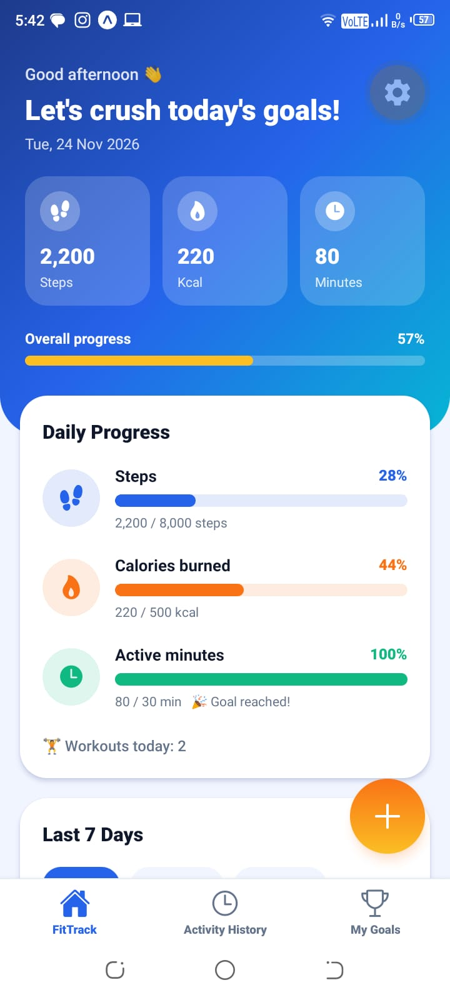
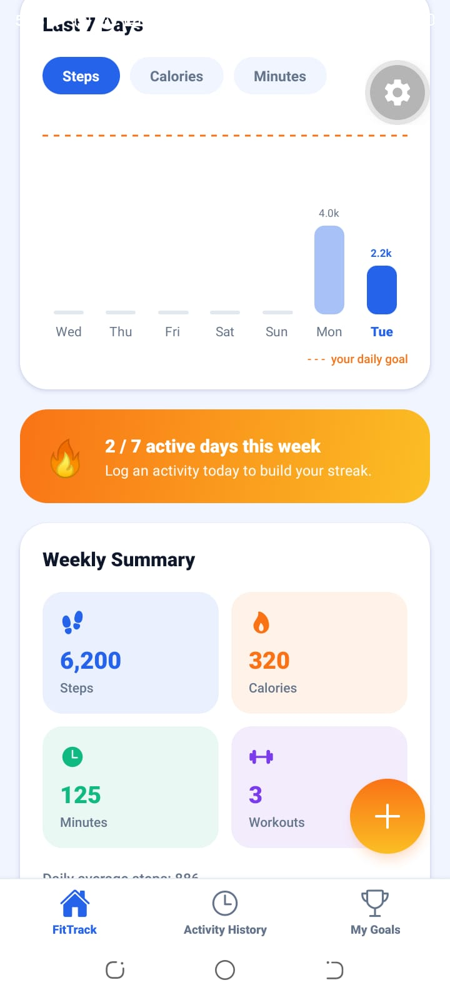
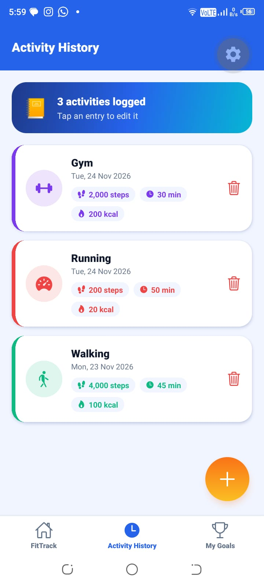
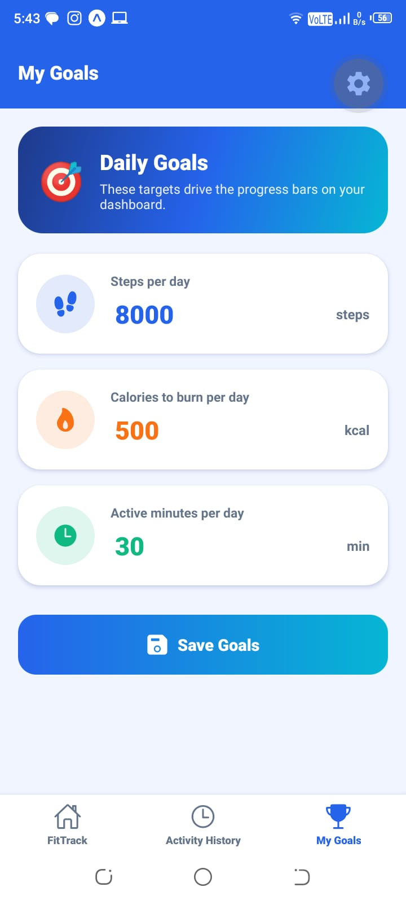

# CodeAlpha_FitnessTracker

A simple, clean fitness tracking mobile app built with **React Native (Expo)** and **SQLite** as part of the **CodeAlpha App Development Internship (Task 3)**.

## Features
- Log daily activities manually: steps, workout type, duration, and calories burned
- Dashboard with daily progress bars and a 7-day bar chart (steps / calories / minutes)
- Weekly summary: totals, workout count, and daily average steps
- History screen to view, edit, and delete entries
- Customizable daily goals
- Offline storage with SQLite, so data stays on the device

## Tech Stack
- React Native + Expo
- expo-sqlite (local database)
- React Navigation (bottom tabs + stack)
- @expo/vector-icons

## Screenshots
<p>
  
  
  
  
</p>

## Getting Started
```bash
git clone https://github.com/SadafHameedKhan/CodeAlpha_FitnessTracker.git
cd CodeAlpha_FitnessTracker
npm install
npx expo start
```
Scan the QR code with the **Expo Go** app on your phone.

## Project Structure
```
App.js
src/
  theme.js
  utils.js
  db/database.js
  components/ (ProgressBar, BarChart, Fab)
  screens/ (Dashboard, History, AddEntry, Goals)
```


